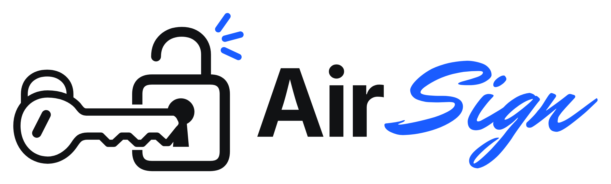
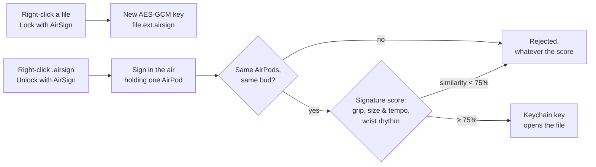
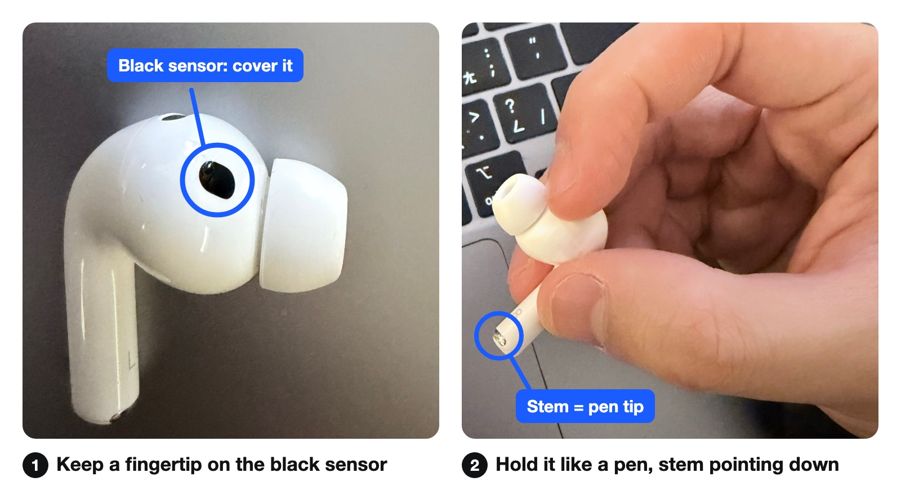

<p align="center">
  <picture>
    <source media="(prefers-color-scheme: dark)" srcset="docs/brand/airsign-wordmark-dark-2400.png">
    
  </picture>
</p>

<p align="center">
  <b>Lock any file on your Mac with a signature you draw in the air, holding one AirPod.</b><br>
  No password to leak. No fingerprint to give away. Just your AirPods, your grip and the rhythm of your wrist.
</p>

<p align="center">
  
  
  
  
  
</p>

<p align="center">
  <a href="#how-it-works">How it works</a> ·
  <a href="#what-we-measured">What we measured</a> ·
  <a href="#install">Install</a> ·
  <a href="#pairing-a-second-mac">Pairing a second Mac</a> ·
  <a href="#security-model">Security model</a> ·
  <a href="#roadmap">Roadmap</a> ·
  <a href="archive/makeuc-2026/technical-guide-zh.md">中文技術文件</a>
</p>

---

## Why AirSign

- **Passwords leak and get reused.**
- **Not every Mac has Touch ID**, and some people won't hand their body's biometrics to any computer.
- **A fingerprint is yours for life** and is left on every cup you touch. An air signature can be changed if it ever leaks.
- **Computers are shared; AirPods are personal.** Someone using their own AirPods is turned away whatever their signature scores.

Think of it as a second lock for the files that matter: if someone sits down at your unlocked Mac, what you locked stays locked unless they can reproduce your signature on your AirPods.

## Highlights

| | |
|---|---|
| ✍️ **Sign in the air** | Hold one AirPod with a finger over its in-ear sensor and sign. Its gyroscope and accelerometer record how you move, not just the shape. |
| 🗂️ **Right-click in Finder** | **Lock with AirSign** turns `report.pdf` into `report.pdf.airsign`, or a whole folder into `Folder.airsign` (up to 500 MB); **Unlock with AirSign** brings it back. |
| 🔐 **Real encryption** | Every file gets its own AES-GCM key. Without the key the content is ciphertext, not just hidden. |
| 🎧 **One gate, one score** | Your AirPods and bud must match; then one score combines your grip, your size and tempo, and the wrist rhythm nobody can see from across the room. |
| 💪 **Signature strength meter** | Like a password meter: a signature that is too short, has too little movement, too few changes of direction, or goes mostly one way is refused at enrollment. |
| 📊 **Similarity score** | 100% means identical to your enrollment, 75% is the pass mark. A closeness score, not a probability. |
| 🌀 **3-D signature preview** | Drag to turn your signature and see it from any angle. |
| 🔄 **Follows your drift** | After an unlock at 80% similarity or more, you can add that signature to your enrollment (up to 2 extra, the originals always kept). The pass mark never moves. |
| 🛟 **Recovery code** | A 32-character code opens your files on any Mac if you lose your AirPods. |
| 🚫 **Escalating lockout** | 5 wrong tries lock signing for 5 minutes, then 15 minutes, 1 hour, 4 hours. |
| 🏠 **Stays on your Mac** | No accounts, no cloud, no network code at all. |

## How it works



1. **Enroll.** Sign three times. AirSign rates the signature's strength, then asks for three more signatures as a check: if any of them fails, the enrollment wasn't steady enough and you start over. It records which AirPods and which bud you used and shows a recovery code once.
2. **Lock.** Right-click any file or folder → **Lock with AirSign**. A folder is packed into one archive first, so its file names and structure are hidden too. The original goes to the Trash only after the locked copy has been read back, decrypted and matched to the original by SHA-256.
3. **Unlock.** Right-click the `.airsign` file → **Unlock with AirSign**, press Space, sign, hold still.

**What is checked**

| Check | What | Decides |
|---|---|---|
| Your AirPods | The same AirPods (sound-output ID) and the same bud as at enrollment | Yes, on its own: a mismatch is rejected |
| Grip and plane | How the AirPod is tilted through the signature (gravity) | Together, as one score |
| Size and tempo | Acceleration, and how long the signature takes | Together, as one score |
| Wrist rhythm | Rotation rate from the gyroscope | Together, as one score |

The score is a banded dynamic-time-warping distance to your three enrolled signatures. The pass mark adapts to you: 1.25 × the largest difference between your own enrolled signatures. In demo mode the app shows, for each part, how far it was from your enrollment.

## What we measured

We built a logged test lab into the app and ran it on two Macs during the event: the owner signing; teammates signing their own names on the owner's AirPods; imitating after watching once; and imitating after practising with a video. Protocol (in Chinese): [archive/makeuc-2026/test-protocol.md](archive/makeuc-2026/test-protocol.md). Session records: [archive/makeuc-2026/test-sessions.md](archive/makeuc-2026/test-sessions.md).

**First session, both Macs**

| Who | Attempts | Got in |
|---|---|---|
| Owners signing their own signature | 41 | **40** (similarity 75–85%) |
| Imitators: own signature on the owner's AirPods | 30 | **0** |
| Imitators: watched once, or practised with a video | 81 | **0** (closest: 72%) |
| Owner holding the *other* bud | 20 | 0 |
| Owner using a *different* pair of AirPods (Mac 1 only) | 10 | 0 |

0 of 111 imitator attempts were accepted: for these two imitators, that is at most about 2.7% per attempt at 95% confidence (3.7% for the 81 watched or practised). Attempts by the same two people aren't independent, so read that as a rough bound.

**What surprised us: signatures drift.** Same owner, same enrollment, same Mac, about 2 and 2.5 hours later: 18/25, then 19/40 (42 logged; two rejected false starts of 0.8 s and 1.9 s left out). A long, complex signature (5.4 s, 117 changes of direction) slowly moved away from its enrollment: 5 of those 40 later tries scored worse than the closest imitator, so no threshold alone can fix it.

- The strength meter and the three-signature check fix other problems we found (very short signatures, and an unsteady first enrollment on Mac 2). They don't fix drift: the drifting signature rated Strong and passed 20/20 right after enrolling.
- A threshold factor of 1.35, chosen after the second sitting and fixed before the later ones, would have let the owner in 34/40 times instead of 19/40 and still rejected all 111 first-session imitator attempts, narrowly. In the final session it would have let 2 of 50 imitations of the new signature through (both Tester B's), so the app keeps 1.25.
- Adding a verified signature from each later sitting to the enrollment kept more owner tries in an offline replay (36/39 instead of 28/39). That is optimistic, since it reuses those sittings; the app now offers it after strong unlocks.

**After a night's sleep** the owner switched to a simpler signature (1.7 s, strength Fair): 20/20 the next morning (similarity 76–81%), and two imitators who watched it got in 0/50: Tester B 0/10, coming as close as 74% against the 75% pass mark, and Tester C 0/40, never above 62%. Simpler signatures are steadier and easier to copy; the strength meter is there to keep that balance.

**Caveats we want you to know**

- Mac 2's first logged enrollment was unsteady (owner 12/20) and was deleted, with 21 earlier unlogged attempts, before any imitator tried. Its owner's signature (1.2 s) would now fail the strength meter.
- At the start of the second sitting the owner was locked out after at least 5 rejected sign-ins to open the test lab; those aren't logged.
- The final session was cut short to make the deadline: only the new signature, two imitators, on Mac 1.
- One teammate is both an imitator and the analyst. To limit that, the matcher and its 1.25 factor were frozen before any test data existed.

## Install

Requirements: a Mac with Apple silicon and macOS 14 or later; AirPods with head tracking (tested with AirPods Pro 3 and AirPods 4); Xcode 16 or later with an Apple Development certificate (Xcode → Settings → Accounts → Manage Certificates → + → Apple Development).

```bash
git clone https://github.com/eric20041027/AirSign.git
cd AirSign/airsign
swift test               # the core: matcher, crypto, file locking, lockout
scripts/install.sh       # builds, signs, installs to ~/Applications, registers the Finder items
```

No Apple Development certificate? Run `AIRSIGN_ADHOC=1 scripts/install.sh` instead; macOS may then ask for your password after each rebuild.

If the Finder items don't appear, enable them in System Settings → Keyboard → Keyboard Shortcuts → Services → Files and Folders.

## Quick start

1. **Enroll.** Open AirSign, hold one AirPod as described below, press Space, sign in the air for about 2 seconds, then hold still. Sign 3 times, then 3 more times as a check. Write down the recovery code before you click *I wrote it down*: it is shown only once.
2. **Lock.** Right-click any file or folder in Finder → **Lock with AirSign**.
3. **Unlock.** Right-click the `.airsign` file → **Unlock with AirSign**, press Space, sign, then hold still.

**How to hold the AirPod:** keep the other AirPod in its case. Hold this one like a pen, with the bottom of the stem as the pen tip, and keep a fingertip on the **black sensor on the inner side**, where it would touch your ear. AirPods stop sending motion when that sensor is uncovered. If AirSign shows *Hold an AirPod with a finger over its sensor*, move your fingertip onto it.

<p align="center">
  
</p>

## Pairing a second Mac

1. Enroll a signature on the second Mac with its own AirPods.
2. Copy one file locked on the first Mac to the second Mac. Right-click it → **Unlock with AirSign**, then click **Use recovery code…**.
3. Enter the first Mac's recovery code, tick **Remember on this Mac** and click **Unlock**. From then on, the first Mac's files open on the second Mac with the second Mac's AirPods and signature.

Pairing is one-way. It stores the first Mac's recovery key in the second Mac's login Keychain, in the `paired-recovery-keys` item. The second Mac can then open the files the first Mac locked under the recovery code used to pair. That code stays the same when you change the first Mac's signature. Resetting AirSign on that Mac or enrolling from scratch replaces the code, so pair again with the new code and keep the old code for files locked before.

On the second Mac, Settings → **Forget paired Macs** removes the stored keys. Saving a new enrollment from scratch or after a reset also forgets pairings.

## Uninstall

Deleting AirSign's Keychain items removes the master key, so existing `.airsign` files will then open only with your recovery code. Unlock anything you want to keep first. Then quit AirSign and run these from the root of your clone:

```bash
LSREGISTER=/System/Library/Frameworks/CoreServices.framework/Frameworks/LaunchServices.framework/Support/lsregister
"$LSREGISTER" -u ~/Applications/AirSign.app
"$LSREGISTER" -u airsign/build/AirSign.app
rm -rf ~/Applications/AirSign.app airsign/build "$HOME/Library/Application Support/AirSign"
defaults delete com.makeuc.airsign
for account in profile-key master-key paired-recovery-keys lockout selftest; do
  security delete-generic-password -s com.makeuc.airsign -a "$account" >/dev/null
done
/System/Library/CoreServices/pbs -update   # refreshes the Finder right-click items
security find-generic-password -s com.makeuc.airsign   # should report that the item could not be found
```

Errors saying an item or domain doesn't exist are fine: not every install creates all of them.

## Security model

| Attacker | Stopped? | Why |
|---|---|---|
| Copies or emails your `.airsign` file | ✅ | The key never leaves your Mac's Keychain |
| Uses your unlocked Mac while you're away | ⚠️ Partly | They must use your AirPods and match your signature. The lockout slows them for up to 4 hours, but someone using your Mac as you can put AirSign's saved state back and try again, so it is only a delay |
| Steals your AirPods | ⚠️ Partly | They also need your Mac, and then it's the imitation case below |
| Tries with their own AirPods | ✅ | Rejected whatever the score (a deterrent: the AirPods' ID is not a secret key) |
| Watched you sign and imitates | ⚠️ Partly | 0/81 watched or practised in our tests, see above |
| Knows your Mac login password and reads the Keychain | ❌ | The signature guards the key; it isn't the key (see roadmap) |
| Reads the Keychain of a Mac you paired | ❌ | A paired Mac keeps the other Mac's recovery key, which is as good as its recovery code |
| Has your recovery code and the file | ❌ | The code is a master key: keep it offline |

**Encryption in short:** each file is sealed with its own 256-bit AES-GCM key; the header is authenticated with the content. That key is wrapped twice: with a master key in the login Keychain, and with HPKE (X25519, ChaCha20-Poly1305) to a public key derived from your recovery code. Turn on FileVault and empty the Trash after locking to get the full protection.

A restart followed by a clock change also ends a cooldown. If AirSign is force-quit while restoring, a hidden plaintext `.airsign-partial-…` item can stay next to the locked file until AirSign next unlocks something in that folder. On a drive that cannot rename without replacing, such as exFAT or FAT, a single restored file is written straight to its final name, so a force-quit during the copy can leave an incomplete file under that name while the locked file stays and nothing is overwritten.

## Under the hood

- **Swift + SwiftUI** app with Finder Services menu items; core logic in a tested `AirSignCore` library; the package has 113 unit tests.
- **CoreMotion** `CMHeadphoneMotionManager` streams the AirPod's attitude, rotation rate, acceleration and gravity (we measured 50 Hz on AirPods Pro 3 and 25 Hz on AirPods 4).
- **Matcher:** 9 features per sample, banded DTW (25% band), a duration penalty, the minimum distance to the enrolled templates.
- **CryptoKit** for AES-GCM and HPKE; the **Keychain** for the master key and a copy of the lockout counter.

## Roadmap

- Follow natural drift further: enroll across days, and measure how much the added signatures help over weeks.
- Derive the key from the signature itself (a fuzzy extractor), or release it from the Secure Enclave, so there is no readable stored key.
- A larger evaluation: more owners and imitators, sessions days apart, a public dataset.
- An iPhone relay, so Windows and Linux laptops can use AirPods too.
- A duress signature that opens a decoy.

## Repository

| Path | What's there |
|---|---|
| [`airsign/`](airsign/) | The Swift package: `AirSignCore` (matcher, crypto, file locking, lockout) and the `AirSign` app |
| [`docs/`](docs/) | Brand files, images and development plans |
| [`archive/makeuc-2026/`](archive/makeuc-2026/) | Hackathon records: test protocol and sessions, tuning, Devpost text, demo script, team plan (some in Chinese) |
| [`tools/`](tools/) | Python ports of the matcher for tuning and the algorithm comparison |
| [`spikes/airpods-motion/`](spikes/airpods-motion/) | The first prototype that proved the AirPods signal |

## Contributing

Bug reports, fixes and tests are welcome: see [CONTRIBUTING.md](CONTRIBUTING.md). Report security problems privately as described in [SECURITY.md](SECURITY.md), and follow the [code of conduct](CODE_OF_CONDUCT.md).

## Team

Three students at MakeUC 2026: core and integration, Finder integration and second-Mac testing, tuning, write-up and video. We wrote a design and a task-by-task plan first, then built the core test-first, with Claude Code and Antigravity as coding assistants. Logo and font credits: [CREDITS.md](CREDITS.md).

The name is shared with earlier, unrelated work: Shao, Yang, Wang and Ma's "AirSign: Smartphone Authentication by Signing in the Air" (*Sensors* 21(1):104, 2020, doi:10.3390/s21010104) verifies signatures drawn in the air with a smartphone.

## License

MIT, see [LICENSE](LICENSE). Brand files are included; see [CREDITS.md](CREDITS.md) for the fonts.
