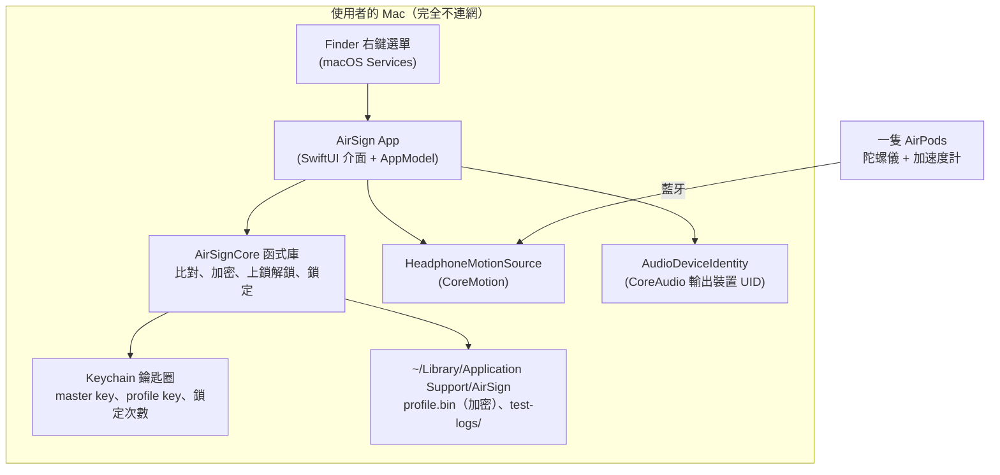
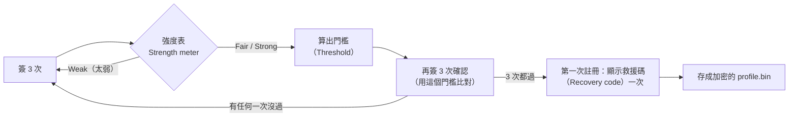
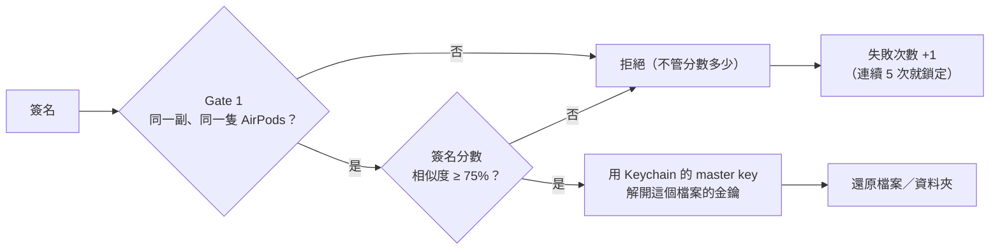

# AirSign 技術文件（中文）

給團隊看的完整說明：AirSign 在做什麼、每一步怎麼運作、用到哪些技術、我們測出了什麼。第一次出現的英文名詞會附上中文解釋，文件最後有完整的[名詞解釋](#10-名詞解釋glossary)。

> App 程式碼以 `feat/enroll-confirm-3d` 分支為準（計畫在 S3 之後合併到 `main`）；文件與 `tools/` 以 `main` 為準。檔名都是相對於 repo 根目錄。

---

## 1. 一句話說明

**拿著一隻 AirPods、手指蓋住它的入耳感應點，在空中簽名，就能替 Mac 上的檔案或資料夾上鎖、解鎖。**

- 上鎖：在 Finder 對檔案按右鍵 → **Lock with AirSign**，檔案被加密成 `檔名.airsign`。
- 解鎖：對 `.airsign` 按右鍵 → **Unlock with AirSign**，簽名通過就還原。
- 判斷「是不是本人」靠兩件事：**用的是不是同一副、同一隻 AirPods**，以及**簽名的動作像不像你註冊時的樣子**。

**為什麼要做**

- 密碼會外洩、會被重複使用。
- 不是每台 Mac 都有 Touch ID，有些人也不想把指紋交給電腦。
- 指紋一輩子換不掉，還會留在你摸過的每個杯子上；空中簽名外洩了可以換一個。
- 電腦常常是共用的，AirPods 通常是個人的。

---

## 2. 系統總覽



| 部分 | 檔案 | 做什麼 |
|---|---|---|
| App 介面 | `airsign/Sources/AirSign/Views/*` | 首頁、註冊、解鎖、測試實驗室、設定 |
| App 邏輯 | `airsign/Sources/AirSign/AppModel.swift` | 串起整個流程：錄簽名 → 比對 → 開檔、鎖定、儲存 |
| 讀 AirPods 動作 | `HeadphoneMotionSource.swift` | 用 `CMHeadphoneMotionManager` 收動作資料 |
| 辨識是哪副耳機 | `AudioDeviceIdentity.swift` | 讀目前聲音輸出裝置的 UID，只接受藍牙耳機 |
| Finder 右鍵 | `ServicesProvider.swift`、`Resources/Info.plist` | 註冊「Lock / Unlock with AirSign」兩個 Services |
| 核心（有單元測試） | `airsign/Sources/AirSignCore/*` | 比對、加密、檔案和資料夾、鎖定、設定檔儲存 |
| 測試 | `airsign/Tests/AirSignCoreTests/*` | 62 個單元測試（`swift test`；clone 後 61 個會跑） |
| 分析工具 | `tools/`（Python） | 比對器的 Python 版本、調參、S3 分析 |

**技術選擇**：Swift + **SwiftUI**（Apple 的宣告式介面框架）、**Swift Package Manager**（Swift 的套件與建置工具）、**CryptoKit**（Apple 的加密函式庫）、**Keychain**（macOS 安全儲存密鑰的地方）。不用任何第三方套件，也沒有任何網路程式碼。

---

## 3. 使用流程

### 3.1 註冊（Enroll）



1. 手拿一隻 AirPods，手指蓋住入耳感應點（感應點被蓋住，系統才會認為耳機「戴著」並送出動作資料），另一隻放回盒子。
2. 按 Space 開始，在空中簽名，簽完**停住不動**，App 自動結束這一筆。
3. 簽滿 3 次後，**強度表**會評分（見 §4.6）。太弱就拒絕，請你重簽。
4. 用這 3 筆算出門檻，再簽 3 次**確認**（用這個門檻比對）：3 次都要通過，才代表這次註冊夠穩定。
5. 記下**用的是哪副 AirPods、哪一隻**（左或右）。
6. 第一次註冊會顯示 32 字元的**救援碼**，只出現這一次，App 不會保存。

### 3.2 上鎖（Lock）

1. 在 Finder 對檔案或資料夾按右鍵 → Lock with AirSign（不用簽名，就像壓縮檔案一樣）。
2. 每個檔案產生一把新的隨機金鑰，用 **AES-GCM** 加密（§5.2）。
3. **資料夾**會先用系統的 `ditto` 打包成一個 zip，再當成一個檔案加密，所以裡面的檔名和結構也看不到。檔案和資料夾的上限都是 500 MB。
4. 寫出 `.airsign` 後，會**讀回來、解密、用 SHA-256 比對**跟原檔一模一樣，才把原檔移到垃圾桶。任何一步出錯，原檔就不動。

### 3.3 解鎖（Unlock）



- 通過後畫面會停在結果，可以拖曳轉動 3D 軌跡。
- 如果相似度 ≥ 80%，可以按「Add this signature to my enrollment」把這次簽名加進樣本（§4.7）。
- 展示模式（Demo mode）下，Finder 不會跳出來蓋住畫面。

### 3.4 救援碼（Recovery code）

- 掉了 AirPods、或在別台 Mac 上：用救援碼可以在任何 Mac 打開這份註冊之後鎖的所有 `.airsign`。全新註冊會換一組新的救援碼。
- 在自己的另一台 Mac 打勾「Remember on this Mac」，之後那台 Mac 用你的 AirPods 和簽名就能開這台鎖的檔案（**配對 Pairing**）。只有已經註冊過自己簽名的 Mac 才能配對。
- 鎖定期間（§4.8）救援碼也會被拒絕；打錯救援碼也算一次失敗。

### 3.5 換簽名

- 設定 →「Change signature…」，**一定要輸入救援碼**，避免模仿者僥倖通過一次就把簽名換成自己的。
- 換簽名不會換 master key，以前鎖的檔案照樣打得開。
- 全新註冊（刪掉設定重來）才會換新的 master key，並忘記所有配對。

---

## 4. 比對演算法（怎麼判斷是不是本人）

### 4.1 AirPods 給的資料

`CMHeadphoneMotionManager`（CoreMotion 提供的耳機動作 API，macOS 14 起可用）每一筆樣本有：

| 欄位 | 英文 | 意思 |
|---|---|---|
| 姿態 | attitude（quaternion 四元數） | 耳機在空間中的方向 |
| 角速度 | rotationRate（gyroscope 陀螺儀） | 每秒轉多少弧度，代表**手腕節奏** |
| 加速度 | userAcceleration（accelerometer 加速度計） | 扣掉重力後的加速度，代表**動作大小和速度** |
| 重力方向 | gravity | 重力在耳機座標裡的方向，代表**握法和角度** |
| 哪一隻 | sensorLocation | 左耳或右耳 |

取樣率（**sample rate**，每秒幾筆）：我們量到 **AirPods Pro 3 是 50 Hz、AirPods 4 是 25 Hz**。同一時間只有一隻耳機會送資料。

### 4.2 切出一筆簽名（SignatureRecorder）

- 角速度 ≥ 0.6 rad/s 時**開始**，保留前面 3 筆當緩衝。
- 角速度 < 0.3 rad/s 持續 **0.5 秒**就**結束**；最長 8 秒。
- 少於 20 筆樣本 → 太短，丟掉。
- 中途換了另一隻耳機、或資料停了超過 0.3 秒（手指離開感應點）→ 這筆作廢，**不算失敗**。

### 4.3 特徵（Features）

每筆樣本轉成 9 個數字：

```
[ 角速度 x, y, z ÷ 3 rad/s,   加速度 x, y, z ÷ 0.5 g,   重力方向 x, y, z ]
```

除以 3 和 0.5 是為了讓三種資料的數值範圍差不多，誰都不會壓過誰。

### 4.4 動態時間校正（DTW, Dynamic Time Warping）

兩次簽名的速度不會完全一樣。DTW 會把兩條時間序列「拉伸對齊」，找出最相像的對應方式，再算出總距離。

- **Sakoe-Chiba band 25%**：對齊時，每一點只能跟對方大約同一時間點前後 25% 的範圍配對，避免不合理的扭曲，也讓計算變快。
- 距離除以兩條序列的長度和（n + m），長短不同的簽名才能公平比較。
- **長度懲罰**：距離 × (1 + 0.5 × |ln(簽名時間長度比)|)，長度以秒計。簽得太快或太慢，距離都會被放大（分數越高越不像）。
- **分數（score）**：新簽名跟每一筆註冊樣本算距離，取**最小值**。

### 4.5 門檻（Threshold）和相似度（Similarity）

- **門檻 = 1.25 × 註冊樣本之間「最大的兩兩距離」**（worst pair）。你自己簽得越一致，門檻就越嚴。
- 分數 ≤ 門檻 → 通過。
- **相似度 = 100 − 25 × (分數 ÷ 門檻)**，限制在 0–100、無條件捨去：
  - 100% = 跟註冊樣本一模一樣
  - 80% = 跟你自己的註冊樣本彼此一樣接近
  - **75% = 剛好在門檻上**，通過一定 ≥ 75，被拒一定 ≤ 74
  - 這是「相似程度」，**不是「是本人的機率」**
- 一般模式只在解鎖成功後才顯示相似度，避免模仿者照著數字一路修正（**hill-climbing attack**，爬山攻擊）。

**Gate 1（第一關）**：聲音輸出必須是註冊時那副 AirPods（比對 CoreAudio 的裝置 UID），而且是同一隻。不符就直接拒絕，不管分數多少。這只是**嚇阻**：UID 跟耳機的藍牙識別碼綁在一起，不是秘密，所以從來不拿它當加密金鑰。

**燈號（gate lights）**：展示模式（和測試實驗室）會顯示握法、大小和速度、手腕節奏三個燈號，各自標出是註冊差距的幾倍（≤ 1 綠、≤ 1.5 黃、更大是紅），另外還有一個 AirPods 燈號。燈號只是說明，**真正做判斷的只有總分**。

### 4.6 簽名強度表（Signature strength）

像密碼強度表。用 3 筆註冊樣本的中位數計算 4 個指標：

| 指標 | 最低要求（未達到就是 Weak，拒絕） | Strong 的標準 |
|---|---|---|
| 長度 duration | 1.5 秒 | 3 秒 |
| 轉動量 turning（角速度對時間積分） | 3 rad | 6 rad |
| 換向次數 reversals（三軸方向改變的總次數，±0.5 rad/s 以內的抖動不算） | 8 次 | 30 次 |
| 單軸佔比 dominant share（最忙的那一軸佔多少能量） | 85% 以下 | 70% 以下 |

4 項中有 3 項達到 Strong 標準就是 Strong，其他是 Fair。這是根據我們的資料訂的經驗值，不是統計驗證過的切點。

### 4.7 加入樣本：跟著簽名的漂移（Drift）

我們發現簽名會隨時間慢慢改變（§6.3）。解法：

- 解鎖成功而且相似度 **≥ 80%**，才可以把這次簽名加進樣本（測試中最接近的模仿者只有 72%）。
- 原本的 3 筆**永遠保留**，最多再加 2 筆，滿了就換掉最舊的那筆加入的。
- **門檻完全不變**，只是多了「最近的你」可以比對。
- 設定頁可以一鍵「Remove added signatures」。

### 4.8 連續失敗鎖定（Lockout）

- 連續 **5 次**失敗就鎖住，時間依序是 **5 分鐘 → 15 分鐘 → 1 小時 → 4 小時**，一直到你成功一次為止。
- 鎖定次數同時存在 profile.bin 和 Keychain，取比較嚴格的那一個。所以把舊的 profile.bin 複製回來也重設不了。
- 測試實驗室裡的嘗試**不算**失敗次數；但打開實驗室前的身分確認算。

---

## 5. 加密與資料儲存

### 5.1 金鑰放在哪裡

| 東西 | 存在哪 | 用途 |
|---|---|---|
| master key（256 位元） | Keychain（`com.makeuc.airsign` / `master-key`） | 包住每個檔案的金鑰 |
| profile key | Keychain（`profile-key`） | 加密 profile.bin |
| 鎖定次數副本 | Keychain（`lockout`） | 防止靠還原 profile.bin 重設 |
| 配對金鑰 | Keychain（`paired-recovery-keys`） | 開其他已配對 Mac 鎖的檔案 |
| 設定檔 | `~/Library/Application Support/AirSign/profile.bin`（用 AES-GCM 加密） | 註冊樣本、門檻、救援公鑰、鎖定狀態、展示模式 |

Keychain 項目存在這台 Mac 的登入鑰匙圈（login keychain），不會同步到 iCloud。程式有指定 `AfterFirstUnlockThisDeviceOnly`，但沒有使用 data protection keychain，所以這個屬性在 macOS 上不生效；保護來自登入鑰匙圈本身和 App 的程式簽章。

### 5.2 `.airsign` 檔案格式

```
[ "AIRSIGN1"（8 bytes） | 標頭長度（4 bytes） | 標頭 JSON | AES-GCM 密文 ]
```

標頭 JSON 是明文，可以讀到：原始檔名、上鎖時間、兩份「被包起來的檔案金鑰」，資料夾還會多一個 `kind: folder`。

- **檔案金鑰（data key）**：每個檔案各自一把隨機的 256 位元金鑰，用 **AES-GCM** 加密內容。
- **AAD（Associated Data，附加驗證資料）**：標頭被當成 AAD 一起驗證。改了標頭的任何一個字（例如檔名），就解不開。
- 檔案金鑰被**包兩次**：
  1. 用 Keychain 裡的 master key 以 AES-GCM 包起來 → 這台 Mac 簽名通過後用。
  2. 用 **HPKE**（X25519 + ChaCha20-Poly1305）包給「救援碼推導出的公鑰」→ 任何一台 Mac 輸入救援碼就能開。

### 5.3 救援碼怎麼變成金鑰

1. 產生 160 位元隨機數，寫成 32 個 **Crockford base32** 字元（不用 I、L、O、U，避免看錯；輸入時 O 會當 0、I 和 L 會當 1）。
2. 用 **HKDF-SHA256**（salt 為 `airsign-recovery-v1`）推導出 32 bytes，當成 **X25519** 私鑰。
3. App 只保存對應的**公鑰**；救援碼本身從來不存。例外：配對過的 Mac 會把救援碼推導出的**私鑰**存在自己的 Keychain，簽名通過後才用。

---

## 6. 測試與結果

### 6.1 測試實驗室（Test lab）

用 `open -a AirSign --args --test-mode` 開啟才會出現。每次嘗試都會存成一個 JSON（含完整動作資料），存在 `~/Library/Application Support/AirSign/test-logs/`，**不放進 repo**。

| 情境 | 英文 | 誰簽 |
|---|---|---|
| A1 | owner | 本人 |
| A2 | zero-effort（零努力冒充者） | 模仿者用自己的簽名、拿本人的 AirPods |
| A3 | watched once | 看過一次本人簽名後模仿 |
| A4 | skilled | 看影片 3 次、練習 5 分鐘後模仿；S3 時遮住螢幕 |
| A5 | other bud / other pair | 本人用另一隻耳機／另一副 AirPods |

場次：S1（晚上）、S2（約 2 小時後）、S4-extra（再晚一點的額外資料）、S3（隔天早上睡醒後）。完整協定在 [test-protocol.md](test-protocol.md)，紀錄在 [test-sessions.md](test-sessions.md)。

### 6.2 第一場（S1，兩台 Mac）

| 誰 | 次數 | 通過 |
|---|---|---|
| 本人 | 41 | **40**（相似度 75–85%） |
| 模仿者：自己的簽名 | 30 | **0** |
| 模仿者：看過一次或練習過 | 81 | **0**（最接近 72%） |
| 本人用另一隻耳機 | 20 | 0 |
| 本人用另一副 AirPods（只有 Mac 1） | 10 | 0 |

111 次模仿全部失敗。用 **rule of three**（3/n 法則：0 次成功時，95% 信心下真實成功率最多約 3/n），這兩位模仿者每次嘗試的成功率最多約 2.7%。但同一個人的多次嘗試不是獨立的，只能當粗略的上限。

### 6.3 最重要的發現：簽名會漂移

同一個人、同一份註冊、同一台 Mac：

| 場次 | 時間 | 本人通過 | 分數 ÷ 門檻（中位數） |
|---|---|---|---|
| S1 | 18:49 | 20/20 | 0.79 |
| S2 | 20:53 | 18/25 | 0.95 |
| S4 | 21:11–21:36 | 19/40（排除 2 次誤觸） | 1.01 |

- 速度回到跟 S1 差不多，分數還是越來越差，所以不是簽太快，是形狀和節奏在變。
- S4 的 40 次中有 5 次，分數比**最接近的模仿者還差**。所以**只靠放寬門檻救不了**。
- 對策：強度表、加入樣本（§4.7），以及事先登記的 1.35 倍數規則（§6.4）。
- 之後 A 換了一個比較簡單的新簽名（1.7 秒，強度 Fair），同一場內 79/79 通過；要等 S3 才知道它隔夜後穩不穩。

### 6.4 事先登記（Pre-registration）

為了不被說「看了結果才改規則」，每條規則都在「用來檢驗它的資料」**之前**寫進 [test-protocol.md](test-protocol.md) 並 commit：

- 比對方法和 1.25 倍數在任何測試資料之前就凍結。
- 相似度公式在 S2 之前固定。
- **候選倍數 1.35**（看過 S2 本人資料後才選，所以只有 S3 是沒看過的驗證資料）：用 1.35 重算所有模仿嘗試（S1 + S3 遮螢幕的 A4），只要有任何一次通過就維持 1.25，否則採用 1.35。目前 S1 的 111 次在 1.35 下全被擋住，但很接近：最接近的模仿者在門檻的 1.099 倍，1.35 只放行到 1.08 倍。
- **跨時間註冊測試**：比較「只用 S1 的 3 筆」和「加上 S2、S4 各一筆」兩組，主要看 S3。
- 分析程式 `tools/session_analysis.py` 也在 S3 前就 commit。

---

## 7. 安全模型與限制

| 攻擊者 | 擋得住嗎 | 原因 |
|---|---|---|
| 複製或寄走你的 `.airsign` | ✅ | 金鑰不會離開你 Mac 的 Keychain |
| 趁你不在用你的 Mac | ⚠️ 部分 | 要用你的 AirPods 而且簽得夠像；鎖定時間最長 4 小時 |
| 偷走你的 AirPods | ⚠️ 部分 | 還需要你的 Mac，之後就是模仿的情況 |
| 用自己的 AirPods | ✅ | Gate 1 直接拒絕（只是嚇阻） |
| 看過你簽名後模仿 | ⚠️ 部分 | 測試中 0/81 |
| 知道你的 Mac 登入密碼、能讀 Keychain | ❌ | 簽名是在**守護**金鑰，不是金鑰本身 |
| 拿到你的救援碼和檔案 | ❌ | 救援碼等於萬用鑰匙，要離線保存 |

**限制**：只有 macOS（只有 Apple 開放 AirPods 動作資料）；需要 Apple silicon 的 Mac；原檔會先在垃圾桶，要清空才算真的刪除；記得開 **FileVault**（全磁碟加密）。

**未來方向**：直接從簽名產生金鑰（**fuzzy extractor**，模糊萃取器）或放進 **Secure Enclave**（晶片內的安全區）、更大規模的評測、iPhone 中繼、脅迫簽名（打開誘餌檔案）。

---

## 8. 開發與建置

```bash
git clone https://github.com/eric20041027/AirSign.git
cd AirSign/airsign
swift test               # 62 個單元測試（clone 後 61 個會跑：1 個需要沒放進 git 的原型資料）
scripts/install.sh       # 建置、簽章、安裝到 ~/Applications、註冊 Finder 選單
open -a AirSign --args --test-mode   # 開啟測試實驗室
```

- 需要 Xcode 16 以上，以及 **Apple Development 憑證**（程式簽章用；每次重新建置都用同一個簽章，Keychain 才不會一直跳出要求密碼）。
- 開發方式：先寫設計和計畫，再用 **TDD**（Test-Driven Development，測試驅動開發：先寫會失敗的測試，再寫程式讓它通過）。
- 分支：`main` 放文件、`tools/` 和已合併的功能；`feat/enroll-confirm-3d` 是最新的 App：逐步加長的鎖定（含 Keychain 副本）、換簽名需要救援碼、相似度只在通過後顯示、3D 軌跡、確認、強度表、資料夾、加入樣本、App 圖示。`main` 上的舊版 App 還是固定鎖 5 分鐘。

| 路徑 | 內容 |
|---|---|
| `airsign/` | Swift 套件：`AirSignCore` 和 `AirSign` App |
| `docs/` | 設計、測試協定、場次紀錄、Devpost 草稿、展示腳本、品牌檔案 |
| `tools/` | Python：比對器移植、演算法比較、S3 分析 |
| `spikes/airpods-motion/` | 最早證明 AirPods 動作資料可行的原型 |

---

## 9. 展示和問答重點

- **建議**展示前 30–60 分鐘重新註冊（換簽名需要救援碼），練習解鎖幾次，最後一次要成功。現場最多試兩次。這是根據漂移結果的建議，不是測過的數字。
- **被鎖住時救援碼也不能用**，備案是播事先錄好的影片。
- 常見問題：
  - **漂移怎麼辦？** 我們量到了，而且做了加入樣本的功能，門檻完全不放寬。
  - **金鑰不就在 Keychain 裡？** 對，簽名是在守護金鑰；下一步是 fuzzy extractor 或 Secure Enclave。
  - **為什麼不直接用 Touch ID？** 很多 Mac 沒有，有些人不想交出指紋；而且簽名外洩了可以換。
  - **樣本夠嗎？** 不夠大：兩位模仿者、一個晚上，所以我們都給次數和信賴區間，不只給百分比。

---

## 10. 名詞解釋（Glossary）

| 英文 | 中文 | 說明 |
|---|---|---|
| AES-GCM | 進階加密標準・伽羅瓦計數模式 | 同時加密和驗證完整性的演算法；被改過就解不開 |
| AEAD / AAD | 帶附加資料的驗證加密／附加驗證資料（Additional Authenticated Data） | AAD 是不加密但會被一起驗證的資料，我們拿來保護標頭 |
| Accelerometer | 加速度計 | 量加速度的感測器 |
| Apple silicon | Apple 自家晶片 | M1、M2 等；Mac 上的頭部追蹤需要它 |
| Attitude / Quaternion | 姿態／四元數 | 用四個數字表示空間方向 |
| CMHeadphoneMotionManager | 耳機動作管理器 | Apple 讀 AirPods 動作資料的 API |
| CoreAudio device UID | 音訊裝置識別碼 | 系統給每個音訊裝置的 ID，我們拿來確認是同一副 AirPods |
| Crockford base32 | Crockford 32 進位編碼 | 只用 32 個不易混淆的字元表示資料 |
| CryptoKit | — | Apple 的加密函式庫 |
| Ciphertext / Plaintext | 密文／明文 | 加密後／加密前的資料 |
| Data key / Master key | 檔案金鑰／主金鑰 | 每個檔案一把 data key；master key 用來包住所有 data key |
| Ditto | — | macOS 內建的複製和壓縮工具，用來打包資料夾 |
| Drift / Template aging | 漂移／樣本老化 | 同一個人的簽名隨時間慢慢改變 |
| DTW (Dynamic Time Warping) | 動態時間校正 | 把快慢不同的兩條序列對齊後比較距離 |
| Enrollment / Template | 註冊／樣本 | 註冊時存下來拿來比對的簽名 |
| FAR / FRR | 誤接受率／誤拒絕率 | 冒充者被放行的比例／本人被拒的比例 |
| FileVault | — | macOS 全磁碟加密 |
| Fuzzy extractor | 模糊萃取器 | 從「每次都有點不一樣」的生物特徵穩定產生同一把金鑰的方法 |
| Gate 1 | 第一關 | 檢查是不是同一副、同一隻 AirPods |
| Gravity vector | 重力向量 | 重力在耳機座標裡的方向，反映握法 |
| Gyroscope / Rotation rate | 陀螺儀／角速度 | 量轉動快慢；反映手腕節奏 |
| HKDF | 金鑰推導函數 | 從一段秘密穩定推導出新金鑰 |
| Hill-climbing attack | 爬山攻擊 | 攻擊者照著分數回饋，一點一點改進模仿 |
| HPKE | 混合式公鑰加密 | 用對方的公鑰加密，只有持有私鑰的人能解 |
| Hz | 赫茲 | 每秒幾次；取樣率的單位 |
| Imitation / Presentation attack | 模仿攻擊／呈現攻擊 | 模仿攻擊：刻意模仿本人的簽名；呈現攻擊範圍更廣：對感測器出示假體、重播或模仿來冒充 |
| Keychain | 鑰匙圈 | macOS 安全保存密碼和金鑰的地方 |
| Lockout | 鎖定 | 連續失敗後暫時禁止再試 |
| macOS Services | 系統服務 | 讓 App 出現在 Finder 右鍵選單的機制 |
| Pre-registration | 事先登記 | 先寫好分析規則，再收資料，避免事後挑結果 |
| Rule of three | 3/n 法則 | n 次全失敗時，95% 信心下真實比例最多約 3/n |
| Sakoe-Chiba band | 對齊帶寬 | 限制 DTW 能扭曲多遠 |
| Sample rate | 取樣率 | 每秒收到幾筆資料 |
| Secure Enclave | 安全隔離區 | 晶片裡獨立保管金鑰的硬體 |
| SHA-256 | 雜湊函數 | 把資料變成固定長度的指紋，用來確認內容完全相同 |
| Similarity | 相似度 | 我們把分數換算成 0–100%，75% 是通過線 |
| Swift Package Manager | Swift 套件管理 | 建置和測試 Swift 專案的工具 |
| SwiftUI | — | Apple 的介面框架 |
| TDD | 測試驅動開發 | 先寫失敗的測試，再寫程式讓它通過 |
| Threshold | 門檻 | 分數 ≤ 門檻就通過 |
| Wilson interval | Wilson 信賴區間 | 小樣本時比較可靠的比例信賴區間 |
| X25519 / ChaCha20-Poly1305 | — | 金鑰交換演算法／加密演算法，HPKE 用的組合 |
| Zero-effort impostor | 零努力冒充者 | 沒有刻意模仿、直接用自己簽名的人 |
